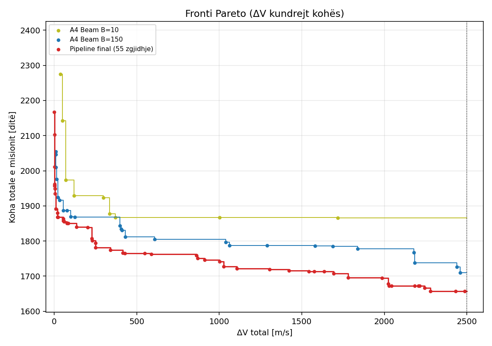
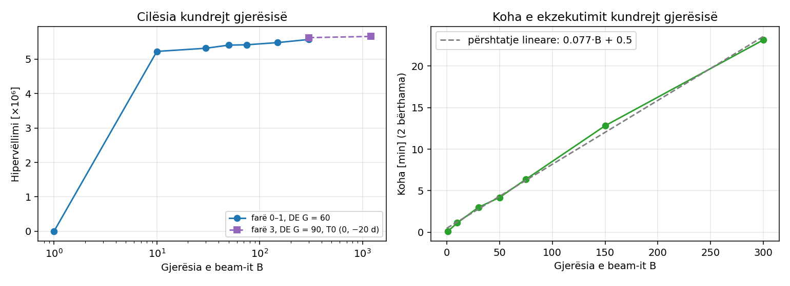
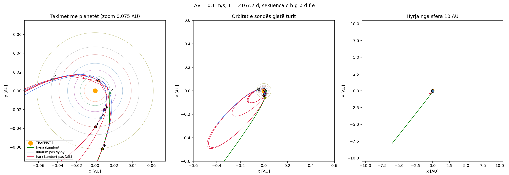
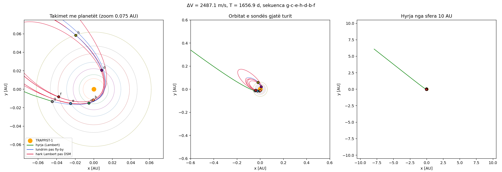

# Trappist Tour – Dizajni dhe Analiza e Algoritmeve

**Autore:** Diona Gerxhaliu · Universiteti i Prishtinës · lënda *Dizajni dhe Analiza e Algoritmeve*

Projekt për problemin **[SpOC: Trappist Tour](https://optimize.esa.int/challenge/spoc-trappist-tour/About)**
të Agjencisë Hapësinore Evropiane (ESA, GECCO 2022): një sondë hyn në sistemin TRAPPIST-1 dhe duhet
të vizitojë të 7 planetët, duke minimizuar njëkohësisht **karburantin (ΔV)** dhe **kohën e misionit**.
Rezultati vlerësohet me **hipervëllimin** e frontit Pareto (pika referuese [2500 m/s, 4000 ditë]).

📄 **Raporti i plotë:** [`docs/RAPORTI.pdf`](docs/RAPORTI.pdf) (burimi: [`docs/RAPORTI.md`](docs/RAPORTI.md))

## Përmbajtja

- [Rezultati](#rezultati)
- [Problemi](#problemi)
- [Qasja](#qasja)
- [Algoritmet](#algoritmet)
- [Eksperimentet](#eksperimentet)
- [Struktura e projektit](#struktura-e-projektit)
- [Instalimi dhe ekzekutimi](#instalimi-dhe-ekzekutimi)
- [Verifikimi](#verifikimi)
- [English summary](#english-summary)

## Rezultati

| | Hipervëllimi | Vendi në renditjen e SpOC 2022 |
|---|---:|---:|
| **Ky projekt** (beam search + CMA-ES + DP) | **5,667,001** | **3** / 20 |
| NSGA-II, 100k vlerësime | 0 | – |
| Kërkim i rastësishëm, 100k vlerësime | 0 | – |

Zgjidhja më ekonomike: ΔV = 0.1 m/s për 2168 ditë; më e shpejta: 1657 ditë për ΔV = 2487 m/s. Dorëzimi: [`results/final/submission.json`](results/final/submission.json).



## Problemi

TRAPPIST-1 është një yll xhuxh i kuq me 7 planetë të njohur (b, c, d, e, f, g, h). Sonda hyn në
sistem nga një sferë me rreze 10 AU dhe duhet të vizitojë **secilin planet saktësisht një herë**,
në një renditje që zgjidhet lirisht. Trajektorja mund të ndryshohet vetëm në dy mënyra:

- **asistencë gravitacionale (fly-by)** pranë një planeti, pa kosto karburanti;
- **manovër impulsive në hapësirë të thellë (DSM)**, e cila kushton ΔV, pra karburant.

Dy objektivat janë në konflikt: një mision më i shpejtë kërkon më shumë karburant. Prandaj kërkohet
një **front Pareto** me ≤ 100 zgjidhje kompromisi, jo një zgjidhje e vetme.

**Vektori i vendimit (34 numra):**

| Indeksi | Ndryshoret | Kuptimi |
|---|---|---|
| `x[0:3]` | `u, v, T0` | drejtimi i hyrjes në sferën 10 AU dhe koha e hyrjes |
| `x[3:27]` | 6 × `β, rp/rP, η, T` | për çdo hap: këndi i fly-by-t, rrezja e periapsisit, momenti i DSM-së, kohëzgjatja |
| `x[27:34]` | `s0 … s6` | renditja e vizitave (permutacion i 0…6) |

Pra problemi ka një pjesë **kombinatorike** (7! = 5040 renditje), një pjesë **të vazhdueshme** me
27 ndryshore reale dhe shumë minimume lokale, **dy objektiva** dhe një **kufizim** jo të lëmuar
(sonda nuk guxon t'i afrohet yllit më shumë se 10 rreze yjore).

## Qasja

Algoritmet gjenerike (kërkim i rastësishëm, NSGA-II) nuk gjejnë asnjë zgjidhje brenda pikës
referuese, edhe me 100 000 vlerësime. Arsyeja është se një tur i mirë kërkon që **të gjashtë hapat**
të jenë njëkohësisht të mirë, ndërsa hapësira e kërkimit është shumë e madhe.

Prandaj problemi **dekompozohet hap pas hapi**:

1. **Modeli fizik në NumPy.** Funksionet e `pykep` që përdor vlerësuesi zyrtar (Lambert sipas Izzo,
   propagim Kepler, fly-by) janë rishkruar në Python/NumPy dhe janë verifikuar me integrim numerik.
   Versionet e vektorizuara llogarisin mijëra trajektore njëherësh.
2. **Beam search shumë-objektiv (A4).** Turi ndërtohet planet pas planeti. Për çdo zgjerim:
   - *Lambert-screening* – një rrjet i shpejtë kohësh hedh poshtë hapat e pashpresë;
   - *Differential Evolution* e vektorizuar optimizon parametrat e atij hapi;
   - në çdo nivel ruhen B gjendjet më të mira sipas **renditjes Pareto** dhe një vlerësimi
     *lookahead* (si A*) për koston e hapave të mbetur.
3. **Lustrimi me CMA-ES (A5).** Turet e plota përmirësohen lokalisht, sepse optimumet shtrihen në
   lugina shumë të ngushta.
4. **Përzgjedhja me programim dinamik (A6).** Nga të gjitha zgjidhjet e gjetura zgjidhet saktësisht
   nënbashkësia me ≤ 100 pika që jep **hipervëllimin maksimal**.

## Algoritmet

| # | Algoritmi | Ideja | Kompleksiteti |
|---|---|---|---|
| A1 | Kërkim i rastësishëm | bazë, mostra uniforme | O(N) vlerësime |
| A2 | NSGA-II | evolucionar shumë-objektiv gjenerik (SBX + OX1) | O(N) vlerësime + O(MN²)/gjeneratë |
| A3 | Greedy | turi ndërtohet hap pas hapi, zgjedhja më e mirë lokale | O(n²) zgjerime |
| A4 | **Beam search shumë-objektiv** | dekompozim sipas hapave; Lambert-screening + Differential Evolution; seleksion Pareto me *lookahead* | O(n²·B·(m + W·NP·G)) |
| A5 | CMA-ES | lustrim lokal i tureve të plota (luginat e ngushta) | O(E·d²) |
| A6 | Programim dinamik | nënbashkësia optimale me ≤ 100 pika (hipervëllim maksimal) | O(k·n²) |

## Eksperimentet

Të gjitha ekzekutimet ruhen në [`results/runs/`](results/runs) (log + `.pkl`), dhe tabela
përmbledhëse është në [`results/summary.md`](results/summary.md). Eksperimentet përfshijnë:

- **krahasimin me bazat** – kërkim i rastësishëm, NSGA-II (3 farë secili) dhe greedy;
- **shkallëzimin e beam search** sipas gjerësisë B = 10, 30, 50, 75, 150, 300;
- **ablacionet** – vetëm Lambert-screening, vetëm DE;
- **ndjeshmërinë** ndaj kohës së hyrjes T0.

| Fronti Pareto | Shkallëzimi sipas B |
|---|---|
|  |  |

| Trajektorja me ΔV minimal | Trajektorja më e shpejtë |
|---|---|
|  |  |

Figurat e trajektoreve tregojnë projeksionin në rrafshin x–y (pamje nga lart). Llogaritjet bëhen në 3D.

## Struktura e projektit

```
official/trappist_tour_official.py   kodi zyrtar i ESA-s (i paprekur, kërkon pykep)
trappist/astro.py                    Lambert (Izzo), propagim Kepler, fly-by  – port i pykep
trappist/problem.py                  funksioni i fitnesit, rresht për rresht si ai zyrtar
trappist/vec.py, lambert_vec.py      versione të vektorizuara (NumPy) për kërkimin
trappist/mga.py                      modeli i shpejtë Lambert + fly-by analitik
trappist/legopt.py                   Differential Evolution për një hap (i vektorizuar)
trappist/beam.py                     A3/A4 – beam search shumë-objektiv
trappist/baselines.py                A1/A2 – kërkim i rastësishëm, NSGA-II
trappist/local.py                    A5 – CMA-ES
trappist/hv.py                       hipervëllimi + A6 (programim dinamik)
trappist/plotting.py                 figurat (pa pykep)
scripts/                             ekzekutimi i eksperimenteve, figurat, raporti, verifikimi
tests/                               verifikimi i modelit fizik me integrim numerik
docs/                                raporti (MD + PDF) dhe shabllonet e tij
figures/                             figurat e raportit
results/final/submission.json        zgjidhja për platformën Optimize (≤ 100 vektorë)
results/runs/                        log-et dhe rezultatet e çdo eksperimenti
```

## Instalimi dhe ekzekutimi

Varësitë janë vetëm `numpy`, `scipy`, `matplotlib` dhe `pytest`.

```bash
git clone https://github.com/Diona-coder1/DionaGerxhaliu-TrappistTour.git
cd DionaGerxhaliu-TrappistTour
pip install -r requirements.txt
```

**1. Testet e modelit fizik**

```bash
python tests/test_astro.py && python tests/test_vec.py && python tests/test_hv.py
```

**2. Algoritmi kryesor (A4)** – rreth 13 minuta në 2 bërthama për B = 150:

```bash
python scripts/run_beam.py --width 150 --workers 2 --seed 0 --out results/runs/beam_main.pkl
```

Opsione të dobishme: `--width` (gjerësia B), `--de-G` (gjeneratat e DE), `--offsets` (zhvendosja e T0),
`--no-de` / `--no-screen` (ablacionet).

**3. Bazat (A1, A2)**

```bash
python scripts/run_baselines.py --algo nsga2 --seed 0
python scripts/run_baselines.py --algo random --seed 0
```

**4. Fronti final (A5 + A6) dhe figurat**

```bash
python scripts/make_final.py results/runs/beam_*.pkl --out results/final
python scripts/make_figures.py
```

**5. Raporti** – `scripts/fill_report.py` plotëson `docs/RAPORTI.md` dhe këtë README nga
shabllonet në `docs/templates/`, dhe `scripts/build_pdf.sh` ndërton PDF-në (kërkon pandoc dhe xelatex).

Të gjitha eksperimentet e raportit mund të përsëriten me `scripts/run_experiments.sh` (rreth 2 orë në 2 bërthama).

## Verifikimi

Kontrolli i dorëzimit me modelin e këtij projekti:

```bash
python scripts/verify_submission.py results/final/submission.json
```

Kontrolli me kodin origjinal të ESA-s (opsional, kërkon `pykep` dhe `pygmo` nga conda-forge):

```bash
conda install -c conda-forge pykep pygmo
python scripts/verify_submission.py results/final/submission.json --official
```

---

### English summary

Multi-objective optimisation of the ESA SpOC 2022 *Trappist Tour* problem for a university course on
algorithm design and analysis. The pykep routines used by the official evaluator are re-implemented
in NumPy and validated against numerical integration. The main method is a multi-objective beam
search that decomposes the tour leg by leg (Lambert screening + vectorised Differential Evolution per
leg, Pareto-aware selection with an A*-like lookahead), followed by CMA-ES polishing and an exact
dynamic-programming selection of the 100 solutions with maximal hypervolume. Generic baselines
(random search, NSGA-II, greedy) and ablations are included for comparison. The final front reaches
a hypervolume of 5,635,615, which would place 3rd of 20 on the SpOC 2022 leaderboard.
