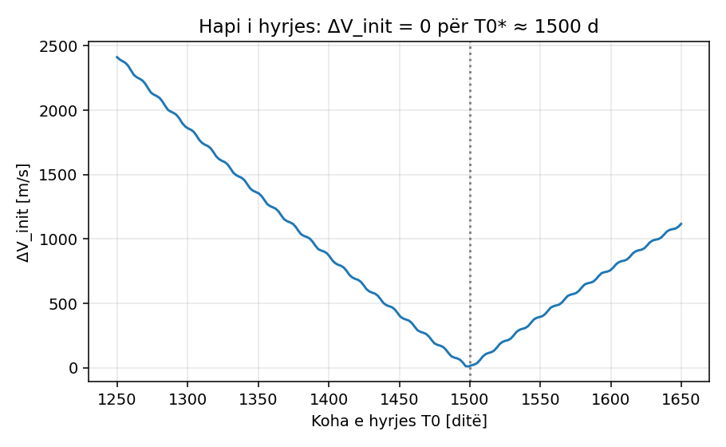
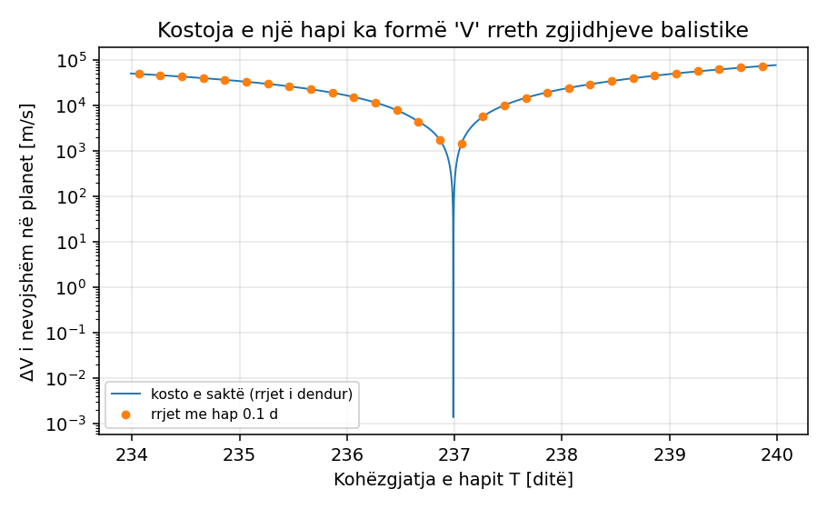
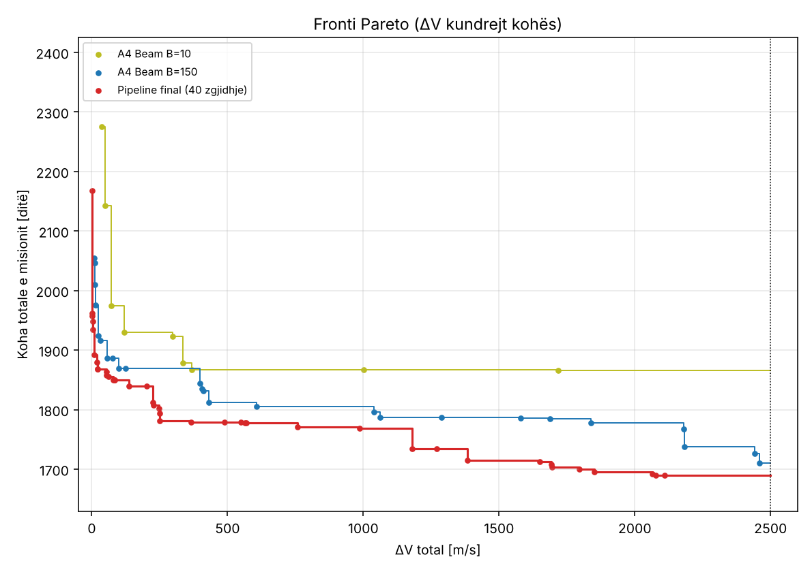
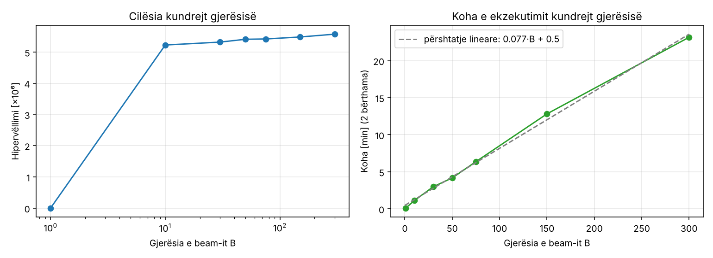
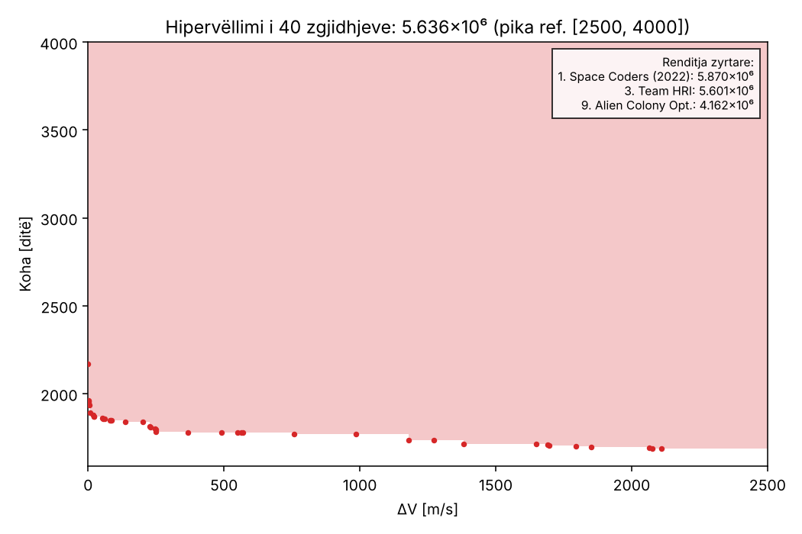
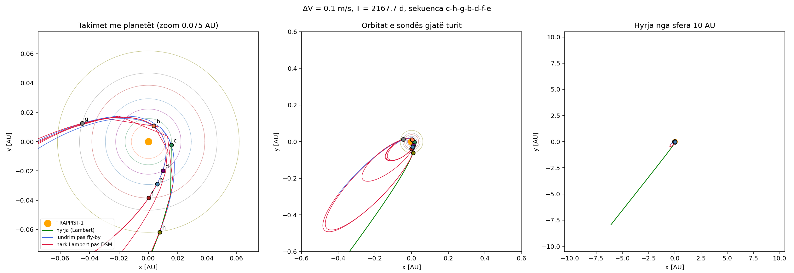
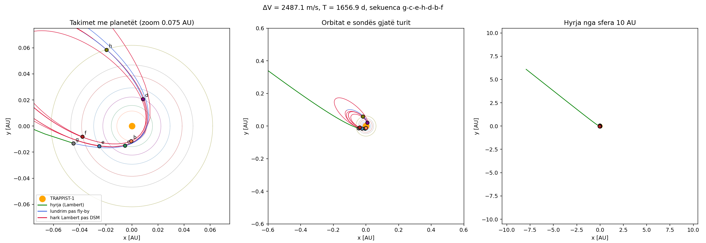

# Hyrje

Problemi **Trappist Tour** është pjesë e garës *Space Optimisation Competition* (SpOC), të
organizuar nga Ekipi i Koncepteve të Avancuara (ACT) i Agjencisë Hapësinore Evropiane (ESA)
bashkë me konferencën GECCO 2022. Problemi zyrtar dhe kodi i vlerësimit gjenden në platformën
*Optimize*: <https://optimize.esa.int/challenge/spoc-trappist-tour/About>.

Një sondë hyn në sistemin yjor TRAPPIST-1 nga një sferë me rreze 10 AU dhe duhet të vizitojë
**secilin nga 7 planetët (b, c, d, e, f, g, h) saktësisht një herë**, në një renditje të zgjedhur
lirisht. Trajektorja mund të ndryshohet vetëm në dy mënyra:

* me **asistencë gravitacionale** (*fly-by*) pranë një planeti, pa kosto karburanti;
* me **manovra impulsive në hapësirë të thellë** (*Deep Space Manoeuvre*, DSM), të cilat kushtojnë
  ndryshim shpejtësie $\Delta V$, pra karburant.

Kërkohen dy objektiva në konflikt: **$\Delta V$ total minimal** dhe **kohë totale e misionit minimale**.
Prandaj nuk ekziston një zgjidhje e vetme optimale, por një **front Pareto** zgjidhjesh kompromisi.
Cilësia e një bashkësie prej $\le 100$ zgjidhjesh matet me **hipervëllimin** (*hypervolume*) në
lidhje me pikën referuese $(2500\ \text{m/s},\ 4000\ \text{ditë})$.

Nga këndvështrimi i lëndës, problemi është interesant sepse kombinon:

1. një pjesë **kombinatorike** (renditja e planetëve: $7! = 5040$ permutacione),
2. një pjesë **të vazhdueshme**, jolineare dhe me shumë minimume lokale (27 ndryshore reale),
3. **dy objektiva**, dhe
4. kufizime që janë jo-të-lëmuara (kontrolli i afrimit me yllin).

Në këtë projekt kemi projektuar, implementuar dhe analizuar gjashtë algoritme, nga ato
gjenerike (kërkim i rastësishëm, NSGA-II), te ato që shfrytëzojnë strukturën e problemit
(kërkim *greedy*, *beam search* shumë-objektiv me dekompozim sipas hapave, CMA-ES lokal dhe
programim dinamik për zgjedhjen optimale të nënbashkësisë).

**Rezultati kryesor.** {{REZULTATI_KRYESOR}}

# Formulimi i problemit

## Vektori i vendimeve

Kodi zyrtar përdor një vektor me 34 komponentë:

| Pjesa | Ndryshoret | Kuptimi | Kufijtë |
|---|---|---|---|
| hyrja | $u, v$ | drejtimi i pikës së hyrjes në sferën 10 AU | $u\in[0,1]$, $v\in[0.25, 0.75]$ |
| | $T_0$ | kohëzgjatja e hapit të hyrjes (ditë) | $[5, 2000]$ |
| 6 hapa | $\beta_k$ | këndi i planit të fly-by | $[0, 2\pi]$ |
| | $r_{p,k}/R$ | distanca e periapsit të fly-by (në rreze të Tokës) | $[1.1, 100]$ |
| | $\eta_k$ | pjesa e hapit pas së cilës bëhet DSM | $[0.001, 0.999]$ |
| | $T_k$ | kohëzgjatja e hapit (ditë) | $[5, 2000]$ |
| renditja | $s_0,\dots,s_6$ | permutacion i $\{0,\dots,6\}$ | numra të plotë |

## Modeli fizik (si e llogarit kodi zyrtar)

Lëvizja modelohet si problem i dy trupave rreth yllit ($\mu = G M_\star$). Për çdo vektor $x$:

1. **Hyrja.** Nga pika në sferë deri te planeti $s_0$ zgjidhet *problemi i Lambert-it*
   (gjej orbitën që lidh dy pozicione në një kohë të dhënë). Kosto:
   $\Delta V_\text{init} = \big|\,\|v_1\| - 10\ \text{km/s}\,\big|$ (sonda nis me 10 km/s).
2. **Për çdo hap $k = 1..6$:** fly-by te planeti $s_{k-1}$ (rrotullon shpejtësinë relative
   me një kënd $\delta(r_p)$ rreth një drejtimi të caktuar nga $\beta$); lundrim kepler-ian
   për $\eta_k T_k$ ditë; DSM; pastaj hark Lambert për $(1-\eta_k)T_k$ ditë deri te planeti $s_k$.
   Kosto e hapit është madhësia e DSM.
3. **Objektivat:** $f_1 = \Delta V_\text{init} + \sum_k \text{DSM}_k$ (m/s) dhe $f_2 = \sum_{k=0}^6 T_k$ (ditë).
4. **Kufizimet:** renditja duhet të jetë permutacion; dhe në çdo hark që kalon periapsin,
   distanca minimale nga ylli duhet të jetë $\ge 834\,840$ km (10 rreze ylli).

## Metrika: hipervëllimi

Për një bashkësi pikash $P$ në hapësirën e objektivave dhe pikë referuese $r$,
$\mathrm{HV}(P)$ është sipërfaqja e zonës që dominohet nga $P$ dhe dominon $r$.
Për dy objektiva, nëse pikat jo-të-dominuara renditen sipas $f_1$:

$$\mathrm{HV}(P) = \sum_{i} \big(f_1^{(i+1)} - f_1^{(i)}\big)\,\big(r_2 - f_2^{(i)}\big),\qquad f_1^{(n+1)} := r_1 .$$

Vlera maksimale teorike është $2500 \times 4000 = 10^7$. Platforma raporton $-\mathrm{HV}$.

# Implementimi dhe verifikimi i modelit

Kodi zyrtar varet nga bibliotekat `pykep` dhe `pygmo`, të cilat shpërndahen vetëm si binare
(conda-forge). Për ta bërë projektin të pavarur, **rutinat astrodinamike u rishkruan në
Python/NumPy** (`trappist/astro.py`) duke ndjekur kodin burimor C++ të `pykep` 2.6:

* zgjidhësi i Lambert-it i Izzo-s (2015) me iteracione Householder;
* propagimi kepler-ian me koeficientët e Lagrange-it (ekuacioni i Kepler-it për elipsë dhe hiperbolë);
* fly-by (`fb_prop`), konvertimet element orbital $\leftrightarrow$ pozicion/shpejtësi;
* funksioni i fitnesit (`trappist/problem.py`) **rresht për rresht si ai zyrtar**.

Kodi zyrtar ruhet i paprekur në `official/trappist_tour_official.py`.

**Verifikimi** (`tests/`). Çdo rutinë krahasohet me një metodë **të pavarur**: integrim
numerik i ekuacioneve të lëvizjes me SciPy (DOP853, tolerancë $10^{-12}$). Gabimet relative
janë $< 10^{-7}$. Zgjidhja shembull e ESA-s jep të njëjtat vlera ($T = 3469.8267$ ditë,
$\Delta V = 2378.99$ m/s, e lejuar). Versionet e vektorizuara (NumPy) krahasohen me ato skalare.

**Vërejtje mbi kodin zyrtar.** Gjatë analizës vumë re disa veçori që ndikojnë drejtpërdrejt në
dizajnin e algoritmeve (dhe që i ruajtëm qëllimisht, sepse serveri vlerëson me këtë kod):

1. Për harqe **hiperbolike** periapsi llogaritet si $-a(1-e) < 0$, kështu që *çdo* hark
   hiperbolik që kalon periapsin shkel kufizimin. Pasojë: hapi i hyrjes duhet ta takojë planetin e
   parë **para** periapsit, dhe fly-by i parë duhet ta "kapë" sondën në orbitë eliptike.
2. Perioda e një harku hiperbolik del `NaN`, kështu që testi `dt > period` është gjithmonë i rremë.
3. Në rastin e "death penalty" funksioni kthen 6 vlera në vend të 4 (gabim i vogël, rrallë aktiv).

# Analiza e strukturës së problemit

Para se të zgjidhnim algoritmet, analizuam problemin. Këto vëzhgime e drejtojnë dizajnin.

**(a) Hapësira e kërkimit.** $5040$ renditje $\times$ $\mathbb{R}^{27}$. Kërkimi shterues është
i pamundur; edhe me vetëm 10 vlera për çdo ndryshore të vazhdueshme do të kishim
$5040\cdot 10^{27}$ kombinime.

**(b) Hapi i hyrjes është praktikisht i ndarë.** $\Delta V_\text{init}$ varet pothuajse vetëm nga
$T_0$ (Figura 1): është $\approx 0$ për $T_0^* \approx 1500$ ditë dhe rritet $\approx 8$ m/s për
çdo ditë të fituar. Pra, rreth 1500 ditë të misionit janë "të detyrueshme" dhe pjesa interesante
është turi me 6 hapa.

{width=60%}

**(c) Kapja dhe "pompimi" i orbitës.** Pas fly-by të parë sonda mbetet në një orbitë shumë
ekscentrike ($e \approx 0.95$, perioda 150–350 ditë). Një hap i shkurtër është i pamundur pa
kosto të madhe, sepse sonda duhet të bëjë rreth një rrotullim. Fly-by-t e njëpasnjëshëm mund ta
**zvogëlojnë periodën** (p.sh. 210 → 120 → 80 ditë) pa karburant. Kjo shpjegon pse një
algoritëm *greedy* që zgjedh hapin më të lirë tani nuk mjafton: duhet *lookahead*.

**(d) Kosto e një hapi ka formë "V".** Nëse DSM vendoset menjëherë pas fly-by, kosto e hapit
$i\to j$ me kohëzgjatje $T$ është mospërputhja mes shpejtësisë që kërkon harku Lambert dhe asaj
që mund të japë fly-by. Ajo bëhet **saktësisht zero** kur $\|v_\text{out,rel}(T)\| = \|v_\text{in,rel}\|$
(zgjidhje *balistike*) dhe rritet shumë shpejt rreth saj (Figura 2). Një rrjet i thjeshtë në $T$
humb qindra m/s; prandaj çdo minimum lokal përmirësohet me **kërkim me prerje të artë** (golden section).

{width=60%}

**(e) Kondicionim shumë i keq.** Ndryshimi i kohës së një hapi me 1 sekondë ndryshon
$\Delta V$ me metra/sekondë, nëse parametrat e fly-by nuk ndryshojnë njëkohësisht. Zgjidhjet e
mira janë në "lugina" shumë të ngushta. Metodat me gradient (provuam SLSQP) dështojnë;
CMA-ES, që mëson formën e luginës, funksionon.

**(f) Fronti përbëhet nga ture të ndryshme.** Ndryshimi i kohës totale me pak ditë ndryshon fazat
e të gjithë planetëve (periodat janë 1.5–19 ditë), prandaj fronti Pareto nuk është një kurbë e
vetme që mund të ndiqet me *continuation*, por bashkësi turesh diskrete. Kjo e bën
**diversitetin e kërkimit** po aq të rëndësishëm sa optimizimin lokal.

# Algoritmet

## A1 – Kërkim i rastësishëm (bazë)

Gjenerojmë $N$ vektorë uniformisht brenda kufijve (renditja si permutacion i rastësishëm) dhe
mbajmë pikat e lejuara jo-të-dominuara.

* Kompleksiteti: $O(N)$ vlerësime + $O(N \log N)$ për frontin.
* Qëllimi: të tregojë sa i vështirë është problemi pa njohuri për strukturën.

## A2 – NSGA-II (algoritëm evolucionar gjenerik shumë-objektiv)

Implementim i plotë i NSGA-II (Deb et al., 2002) për kodimin e përzier:

* pjesa reale (27 gjene në $[0,1]$): kryqëzim SBX + mutacion polinomial;
* pjesa permutacion (7 gjene): kryqëzim OX1 + mutacion me shkëmbim;
* kufizimet: *constrained domination* (zgjidhjet e lejuara para të palejuarave);
* seleksion me turne binar sipas (rangut, distancës së grumbullimit).

Kompleksiteti për gjeneratë: $O(N)$ vlerësime + $O(MN^2)$ për renditjen jo-të-dominuar
($M = 2$ objektiva, $N$ = popullsia).

## A3 – Greedy

Ndërton turin hap pas hapi: në çdo nivel zgjedh vetëm fëmijën më të mirë (beam search me gjerësi 1).
Kompleksiteti: $O(n^2)$ zgjerime, ku $n = 7$. Shërben si rast kufitar i A4.

## A4 – Beam search shumë-objektiv me dekompozim sipas hapave (algoritmi kryesor)

**Ideja.** Turi ndërtohet si një pemë kërkimi: niveli 0 janë hyrjet (planeti i parë $\times$
drejtimi $(u,v)$ në një rrjet $24\times 7$, me $T_0^*$ optimal), niveli $k$ janë turet e pjesshme
pas $k$ fly-by-ve. Çdo nyje ruan: renditjen, epokën, shpejtësinë e mbërritjes, $\Delta V$ e
grumbulluar dhe kohën e grumbulluar. Kjo **dekompozon** problemin 27-dimensional në 6
nënprobleme 4-dimensionale (një për hap), me gjendjen e mbërritjes si "kujtesë" mes tyre.

**Gjenerimi i fëmijëve** për nyjen në planetin $i$ dhe çdo planet të pavizituar $j$:

1. *Lambert screening* (i shpejtë): për ~8 000 kohëzgjatje $T$ në një rrjet me hap 0.04 ditë,
   zgjidhet Lambert-i i vektorizuar dhe llogaritet analitikisht kostoja e fly-by optimal
   (ligji i kosinusit). Minimumet lokale përmirësohen me prerje të artë → gjen zgjidhjet **balistike**.
2. *Differential Evolution* (i saktë): për çdo dritare kohore
   $[5,30], [30,60], \dots, [250,340]$ ditë optimizohen $(\beta, r_p, \eta, T)$ në modelin zyrtar.
   Popullsitë e të gjitha detyrave $(j, \text{dritare})$ bashkohen në **një matricë të vetme** dhe
   vlerësohen me një thirrje NumPy për gjeneratë. DE niset me zgjidhjet nga hapi 1.
3. Çdo kandidat rivlerësohet me modelin e saktë; mbahen fëmijët **jo-të-dominuar** sipas
   ($\Delta V$, $T$) për çdo $j$.

**Seleksioni (beam).** Nga të gjithë fëmijët e nivelit mbahen vetëm $B$. Për të ruajtur
diversitetin dhe karakterin shumë-objektiv:

* përdoren disa shuma të peshuara $\Delta V + \lambda\,(T + h)$, me $\lambda \in \{0,1,2,4,8,16\}$ m/s/ditë
  dhe $B/6$ nyje për secilën ("feta" të frontit);
* $h$ = (hapa të mbetur) $\times$ (perioda e orbitës aktuale) është një vlerësim i kohës që mbetet,
  në frymën e algoritmit A\*; ai shpërblen nyjet që kanë "pompuar" orbitën;
* lejohen maksimum $B/20$ nyje për çdo çift (bashkësia e vizituar, planeti aktual).

```text
BEAM-SEARCH(roots, B):
  L ← SELECT(roots, B)
  for depth = 1..6:
      C ← ∅
      for each node in L:                 # paralel në 2 bërthama
          C ← C ∪ EXPAND(node)            # screening + DE + front lokal Pareto
      L ← SELECT(C, B)  (në nivelin 6: L ← C)
  return L                                # ture të plota

SELECT(C, B):
  S ← ∅
  for λ in Λ:
      sort C by ΔV + λ·(T + h)
      add the first B/|Λ| nodes not in S, respecting the per-key cap
  return S
```

**Kompleksiteti.** Le të jenë $n=7$ planetët, $m$ madhësia e rrjetit kohor, $W$ numri i
dritareve, $N_P\cdot G$ buxheti i DE. Një zgjerim kushton $O\big(n\,(m + W N_P G)\big)$
vlerësime hapi, prandaj i gjithë kërkimi kushton

$$O\big(n \cdot B \cdot n\,(m + W N_P G)\big) = O\big(n^2 B\,(m + W N_P G)\big),$$

pra **linear në $B$** dhe polinomial në $n$, në vend të $O(n!)$ të numërimit shterues
të renditjeve. Kujtesa: $O(B)$ nyje për nivel. Seleksioni kushton $O(|C|\log|C|\cdot|\Lambda|)$.

## A5 – CMA-ES për lustrimin lokal

Për çdo tur të plotë optimizojmë njëkohësisht të 27 ndryshoret (renditja fikse) me
CMA-ES (Hansen & Ostermeier, 2001), implementuar nga zeroja (`trappist/local.py`), me formulim
$\varepsilon$-constraint: minimizo $\Delta V$ me kusht $\sum T_k \le$ buxheti. Për shkak të
kondicionimit të keq, hapi fillestar është i ndryshëm për çdo ndryshore ($\sim$ 1 s për kohët e
hapave, $\sim 10^{-5}$ për të tjerat). Kompleksiteti: $O(E\cdot d^2)$ për $E$ vlerësime në $d=27$ dimensione
(përditësimi i matricës së kovariancës), praktikisht i dominuar nga $E$ vlerësime të fitnesit.

## A6 – Zgjedhja optimale e $\le 100$ zgjidhjeve (programim dinamik)

Platforma pranon maksimum 100 vektorë, kurse algoritmet prodhojnë qindra pika jo-të-dominuara.
Duhet zgjedhur nënbashkësia me hipervëllim maksimal (*Hypervolume Subset Selection Problem*).
Në 2 dimensione ky problem ka **nënstrukturë optimale**: renditim pikat sipas $f_1$; nëse
zgjedhim $i_1 < \dots < i_k$, kontributi i pikës $i_m$ është drejtkëndëshi
$(f_1^{(i_{m+1})} - f_1^{(i_m)})(r_2 - f_2^{(i_m)})$ dhe varet **vetëm nga pika e ardhshme e zgjedhur**. Prandaj

$$\mathrm{best}_c(i) = \max_{j > i}\Big[(f_1^{(j)} - f_1^{(i)})(r_2 - f_2^{(i)}) + \mathrm{best}_{c-1}(j)\Big],\qquad
\mathrm{best}_1(i) = (r_1 - f_1^{(i)})(r_2 - f_2^{(i)}).$$

Kompleksiteti $O(k\,n^2)$ kohë dhe $O(k\,n)$ kujtesë ($k = 100$). Korrektësia u verifikua kundrejt
kërkimit shterues të të gjitha nënbashkësive në teste të rastësishme (`python -m trappist.hv`).

## Pipeline-i i plotë

```text
entry_nodes  →  A4 beam search (disa ekzekutime)  →  bashkimi i tureve
             →  A5 CMA-ES në 3 shtresat e para jo-të-dominuara
             →  A6 nënbashkësia optimale (≤ 100)  →  submission.json
```

# Eksperimentet

**Mjedisi.** Python 3.13, NumPy, SciPy; 2 bërthama CPU. Çdo vlerësim i fitnesit kushton
$\approx 0.8$ ms në Python të pastër; vlerësimi i vektorizuar i një hapi $\approx 3$–$10\ \mu$s.

{{TABELA_REZULTATEVE}}

## Krahasimi i algoritmeve

{width=80%}

{{DISKUTIMI_KRAHASIMIT}}

## Shkallëzimi sipas gjerësisë së beam-it

{width=95%}

{{DISKUTIMI_SHKALLEZIMIT}}

## Ablacionet

{{DISKUTIMI_ABLACIONIT}}

# Rezultati final

{{REZULTATI_FINAL}}

{width=75%}

{width=100%}

{width=100%}

# Përfundime

{{PERFUNDIME}}

# Si të ekzekutohet kodi

```bash
pip install -r requirements.txt
python -m pytest -q tests                      # verifikimi i modelit
python scripts/run_beam.py --width 150         # A4 (~13 min në 2 bërthama)
python scripts/run_baselines.py --algo nsga2   # A2
python scripts/make_final.py results/runs/beam_*.pkl --out results/final
python scripts/make_figures.py
python scripts/verify_submission.py results/final/submission.json
```

Me `pykep`/`pygmo` të instaluara (conda-forge), `scripts/verify_submission.py --official`
rivlerëson çdo zgjidhje edhe me kodin origjinal të ESA-s.

# Referencat

1. ESA Advanced Concepts Team, *SpOC: Trappist Tour*, <https://optimize.esa.int/challenge/spoc-trappist-tour/About>.
2. D. Izzo, "Revisiting Lambert's problem", *Celestial Mechanics and Dynamical Astronomy* 121, 2015.
3. K. Deb, A. Pratap, S. Agarwal, T. Meyarivan, "A fast and elitist multiobjective genetic algorithm: NSGA-II", *IEEE TEVC* 6(2), 2002.
4. R. Storn, K. Price, "Differential Evolution – a simple and efficient heuristic for global optimization over continuous spaces", *J. Global Optimization* 11, 1997.
5. N. Hansen, A. Ostermeier, "Completely derandomized self-adaptation in evolution strategies", *Evolutionary Computation* 9(2), 2001.
6. K. Bringmann, T. Friedrich, P. Klitzke, "Two-dimensional subset selection for hypervolume and epsilon-indicator", GECCO 2014.
7. D. Izzo et al., *pykep* (v2.6), <https://github.com/esa/pykep>.
8. S. Limmer, F. Lanfermann, N. Einecke, "SpOC: approaches by HRI", SpOC Workshop, ESA 2022.
